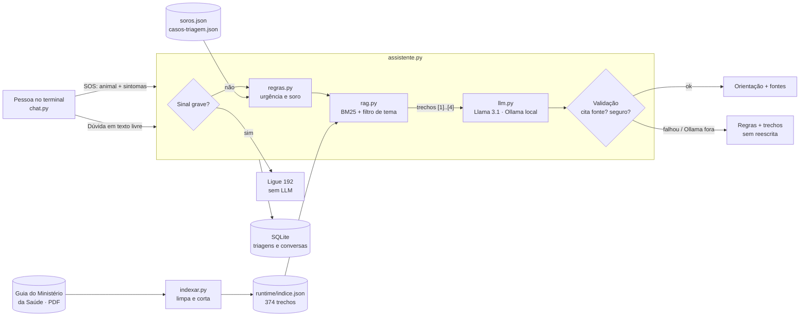

# 🩺 Antídoto IA

> Primeiros socorros para acidentes com animais peçonhentos: as regras decidem a urgência e o soro, o RAG busca no guia oficial do Ministério da Saúde e o Llama explica em linguagem simples.

Global Solution 2026/2 · **CitizenTech** · Disruptive Architectures: IoT, IoB & Generative IA · FIAP

## 📋 Índice
- [O problema e o público](#-o-problema-e-o-público)
- [A funcionalidade de IA](#-a-funcionalidade-de-ia)
- [Arquitetura](#-arquitetura)
- [Modelos, tecnologias e justificativas](#-modelos-tecnologias-e-justificativas)
- [Dados: fontes e preparação](#-dados-fontes-e-preparação)
- [Como executar](#-como-executar)
- [Avaliação e resultados](#-avaliação-e-resultados)
- [Limitações e uso responsável](#-limitações-e-uso-responsável)
- [Requisitos da entrega](#-requisitos-da-entrega)
- [Equipe](#-equipe)

---

## 🐍 O problema e o público

Os acidentes por animais peçonhentos são um desafio de saúde pública no Brasil, e o escorpionismo vem crescendo com espécies adaptadas às cidades, ocupação desordenada e mudanças climáticas, afetando principalmente populações vulneráveis (Guia do Ministério da Saúde, p. 8). O escorpião pica dentro de casa, ao vestir roupas e calçados ou durante o sono (p. 16), e o ofidismo pesa mais na zona rural. Na hora do acidente, quem foi picado, ou quem está socorrendo, precisa saber três coisas: **é grave?**, **o que eu faço agora (e o que não faço)?** e **qual soro procurar?**. Crenças populares como torniquete e passar borra de café, vinagre ou urina na picada ainda são difundidas no interior e podem agravar o envenenamento (p. 160).

**Público:** moradores de zonas rurais e periferias urbanas e quem socorre a vítima.
**Contribuição para o Antídoto (CitizenTech):** o animal define o soro e o soro define a unidade de saúde certa. A IA encurta esse caminho, combate as condutas erradas com a palavra do guia oficial e nunca dispensa atendimento.

## 🧠 A funcionalidade de IA

O **Antídoto IA** roda no terminal ([`chat.py`](IA-antidoto/chat.py)) com dois modos:

| Modo | Entrada | Saída |
| --- | --- | --- |
| **🚨 SOS** | Animal (9 opções, incluindo "não sei") e sintomas | Urgência, soro indicado e o que fazer agora, com as páginas do guia |
| **💬 Dúvidas** | Pergunta em texto livre ("posso fazer torniquete?") | Resposta só com base no guia, citando as fontes, com memória da conversa |

Abordagem **híbrida**: as **regras decidem**, o **RAG encontra** e o **LLM explica**.

| Componente | Técnica | Responsabilidade |
| --- | --- | --- |
| **Motor de regras** ([`regras.py`](IA-antidoto/regras.py)) | Classificação determinística | Urgência (CRÍTICA, ALTA, MÉDIA) e soro. Mesmo critério da API .NET do Antídoto, testado pelos mesmos 22 casos. Nenhum caso cai em BAIXA |
| **RAG** ([`rag.py`](IA-antidoto/rag.py)) | Recuperação BM25 sobre o guia do Ministério da Saúde | Encontra os 4 trechos mais relevantes e os numera `[1]..[4]` com a página |
| **IA generativa** ([`assistente.py`](IA-antidoto/assistente.py) + [`llm.py`](IA-antidoto/llm.py)) | Llama 3.1 8B local via Ollama | Escreve até 5 frases simples usando **só** os trechos e citando `[n]`. Recebe a urgência e o soro como fato e não pode mudar |
| **Guarda de emergência** | Regras | Sinal grave (falta de ar, visão dupla, pálpebra caída, urina escura, sangramento, desmaio, vômitos), marcado no SOS ou escrito na dúvida → "Ligue 192 (SAMU) agora", **sem LLM** |
| **Validação da resposta** | Regras sobre o texto gerado | Descarta a resposta do LLM se não citar trecho, citar trecho que não existe, passar de 1.500 caracteres, dispensar atendimento ("não é perigoso", "pode ficar em casa"…) ou, no SOS, trouxer instrução que o guia dá só para outro animal (tentáculos de água-viva na picada de lagarta, por exemplo) |
| **Fallback** | Trechos sem reescrita | Ollama fora do ar ou resposta descartada → orientação das regras + trechos do guia como estão, com a página. Ninguém fica sem resposta |

### Regras de urgência

| Situação | Urgência |
| --- | --- |
| Qualquer sinal grave | **CRÍTICA** (orientação começa com "Ligue 192") |
| Jararaca, cascavel, surucucu, coral ou animal desconhecido | **ALTA** |
| Escorpião, armadeira, aranha-marrom ou lagarta | **MÉDIA** |

Orientação fixa das regras: *"Lave o local com água e sabão, mantenha a pessoa calma e deitada. Não faça torniquete, não corte, não chupe o local e não passe nada na picada. Vá agora para a unidade indicada."*

### Exemplo real (SOS · jararaca · dor no local e inchaço)

Saída do `avaliar.py` com o Llama 3.1 8B, em 5,1 s (ver [`evidencias/avaliacao-rodada1.md`](evidencias/avaliacao-rodada1.md)):

```
Urgência: 🟠 ALTA · Soro: Soro antibotrópico (SAB)

Lave o local com água e sabão, mantenha a pessoa calma e deitada. Não faça torniquete, não corte,
não chupe o local e não passe nada na picada. Vá agora para a unidade indicada.

Vá imediatamente para a unidade de saúde. Mantenha a vítima em repouso e com o membro acometido
elevado até a chegada ao pronto-socorro. Dê água potável para a vítima beber. Não amarre o membro
acometido e não faça curativo no local da picada. Não aplique qualquer tipo de substância no local
da picada. [1], [2], [3], [4]

Fontes: [1] Guia de Animais Peçonhentos do Brasil (Ministério da Saúde, 2024), p. 164; [2] … p. 165; …
```

O 1º parágrafo vem das regras (sempre igual); o 2º é o Llama reescrevendo a seção "8.9 Primeiros-socorros" do guia só com o que vale para picada de cobra (repouso, membro elevado e água potável são instruções do guia para acidentes ofídicos).

### Integração com o Antídoto

A IA faz parte da solução Antídoto (app mobile + API Java + API .NET) e foi construída para encaixar nela sem tradução:

| Ponto de contato | Como está hoje |
| --- | --- |
| **Mesmos códigos** | Grupos de animal (`JARARACA`, `ESCORPIAO`…), soros (`BOTROPICO`…) e urgências (`CRITICA`, `ALTA`, `MEDIA`) são os mesmos do `Catalogo.cs` da API .NET |
| **Mesma regra de urgência** | `regras.py` reproduz o `RegrasTriagem.cs` do .NET, inclusive o texto da orientação, e os dois são testados pelos mesmos 22 casos de [`casos-triagem.json`](IA-antidoto/data/casos-triagem.json) |
| **Mesmo formato de resposta** | `assistente.triar()` devolve `urgencia`, `soro` e `orientacao`, os três campos que o `IaClient` da API .NET já lê |
| **SOS do app** | O soro indicado pela IA é o filtro que o app usa para listar as unidades de saúde que têm aquele soro |

**Nesta entrega**, a IA roda no terminal (`chat.py`) para ser avaliada de forma isolada e reproduzível, sem depender do app, do banco Oracle ou da nuvem. **Próximo passo:** publicar `assistente.triar()` como `POST /triagem` na porta 8000, rota que o `IaClient` da API .NET já chama, com fallback para as regras locais do .NET se a IA estiver fora do ar.

## 🏗️ Arquitetura



**Fluxo do SOS:** `chat.py` → `assistente.triar()` → `regras.avaliar()` decide → sinal grave? resposta fixa : `rag.buscar()` (consulta mirando a seção de primeiros socorros) → prompt com a decisão + trechos → `chamar_llama()` → `validar_resposta()` → orientação com fontes ou fallback → `db.salvar_triagem()`.

**Fluxo da dúvida:** máscara de dados pessoais → sinal grave no texto? → filtro de tema → BM25 → prompt com trechos + últimas 6 mensagens → Llama → validação → resposta ou fallback → `db.salvar_mensagem()`.

### Estrutura

```
Iot-Antidoto/
├── IA-antidoto/
│   ├── chat.py            # terminal: menu, SOS e dúvidas
│   ├── assistente.py      # triagem, dúvidas, prompts, validação e fallback
│   ├── regras.py          # urgência, soro e sinais graves
│   ├── rag.py             # busca BM25 com filtro de tema
│   ├── indexar.py         # PDF → trechos (runtime/indice.json)
│   ├── llm.py             # cliente do Ollama
│   ├── dados.py           # carga e validação das bases
│   ├── db.py              # SQLite (runtime/antidoto.db)
│   ├── avaliar.py         # avaliação completa → evidencias/
│   ├── data/              # guia em PDF, soros, casos, perguntas e fontes
│   ├── runtime/           # índice e banco gerados (fora do Git)
│   └── tests/             # 72 testes automatizados
├── evidencias/
└── entrega.txt
```

## 🛠️ Modelos, tecnologias e justificativas

Python 3.10+ · Ollama + **Llama 3.1 8B** · BM25 em Python puro · pypdf · SQLite · `unittest`

| Escolha | Por quê |
| --- | --- |
| **Llama 3.1 8B local (Ollama)** | Sem custo por requisição, sem chave de API para vazar e sem dados de saúde saindo da máquina. Responde bem em português. O modelo pode ser trocado por `OLLAMA_MODEL` |
| **RAG como aprofundamento** | Numa emergência, a orientação precisa vir de fonte oficial e ser verificável. O RAG prende o LLM aos trechos do guia do Ministério da Saúde e mostra a página de cada informação. Machine Learning ou visão computacional exigiriam dados rotulados (ex.: milhares de fotos de animais) que não cabem no prazo, e errariam justamente com foto ruim, o caso comum numa emergência |
| **BM25 em vez de embeddings** | Testamos embeddings com o `nomic-embed-text` (Ollama): "qual o horário do jogo do Corinthians?" teve similaridade **0,67** com trechos sobre jararacas, **maior** que "posso fazer torniquete?" (0,62), e o trecho de primeiros socorros não aparecia entre os 4 primeiros. Com 374 trechos de português técnico, o BM25 acerta os termos exatos do guia ("torniquete", "soro", "ferrão"), não precisa de modelo extra e é explicável. Resultado: **90% de recall@4** |
| **Filtro de tema** | Barra perguntas fora do assunto antes de gastar a busca e o LLM: 100% das perguntas fora do tema rejeitadas |
| **Regras decidem, LLM explica** | Urgência e soro precisam ser auditáveis e iguais aos da API .NET. O LLM nunca muda a decisão |
| **SQLite** | Guarda triagens e conversas sem instalar nada (padrão do projeto Afetto) |

## 📚 Dados: fontes e preparação

| Dado | Fonte | Uso |
| --- | --- | --- |
| Guia de Animais Peçonhentos do Brasil (PDF, 166 páginas) | Ministério da Saúde, 2024 · CC BY-NC-SA ([link](http://bvsms.saude.gov.br/bvs/publicacoes/guia_animais_peconhentos_brasil.pdf)) | Base do RAG |
| [`soros.json`](IA-antidoto/data/soros.json) | Grupo (códigos iguais aos da API .NET) | 9 grupos de animal e o soro de cada um |
| [`casos-triagem.json`](IA-antidoto/data/casos-triagem.json) | Grupo (regras da API .NET) | 22 casos que as regras precisam acertar |
| [`perguntas-avaliacao.json`](IA-antidoto/data/perguntas-avaliacao.json) | Grupo, conferido no guia | 20 perguntas com as páginas certas + 5 fora do tema |

Detalhes e licenças em [`data/fontes.md`](IA-antidoto/data/fontes.md).

**Preparação do guia** ([`indexar.py`](IA-antidoto/indexar.py)):
1. Só entram as páginas listadas em [`documentos.json`](IA-antidoto/data/documentos.json) (132 de 166): saem capa, sumário, aberturas de capítulo, tabelas de espécies e referências bibliográficas.
2. Limpeza: cabeçalhos, números de página, pontilhados e tudo depois de "REFERÊNCIAS"; hifenização desfeita (`acumula-do` → `acumulado`, mas `cobra-` + `-coral` → `cobra-coral`); marcadores de lista viram `•`.
3. Corte em trechos de 500 a 800 caracteres terminando no fim da frase, com 150 caracteres de sobreposição. Cada seção numerada ("8.9 Primeiros-socorros") começa um trecho novo.
4. Resultado: **374 trechos** em `runtime/indice.json`, cada um com a página onde começa. Resumo em [`evidencias/indexacao.json`](evidencias/indexacao.json).

**Validação das bases** ([`dados.py`](IA-antidoto/dados.py)): campos obrigatórios, ids únicos, soro existente, urgência válida e só o grupo "desconhecido" sem soro. Base inválida é rejeitada inteira ao iniciar.

## ▶️ Como executar

### 1. Pré-requisitos
- Python 3.10+
- [Ollama](https://ollama.com/download) instalado e aberto

### 2. Instalar
```powershell
cd IA-antidoto
python -m venv .venv
.\.venv\Scripts\Activate.ps1        # Linux/Mac: source .venv/bin/activate
pip install -r requirements.txt
ollama pull llama3.1:8b
```

### 3. Usar
```powershell
python indexar.py      # prepara o guia (uma vez; o chat também faz sozinho se faltar)
python chat.py         # SOS e dúvidas no terminal
```

Sem Ollama o chat continua funcionando, com as regras e os trechos do guia sem reescrita.

### 4. Testar e avaliar
```powershell
python -m unittest discover -s tests -v
python avaliar.py              # gera evidencias/avaliacao.md (com o Llama)
python avaliar.py --sem-llm    # sem Ollama
python rag.py "posso fazer torniquete?"   # ver só a busca
```

### Configuração (opcional, por variável de ambiente)

| Variável | Padrão | Para quê |
| --- | --- | --- |
| `OLLAMA_HOST_URL` | `http://localhost:11434` | Endereço do Ollama |
| `OLLAMA_MODEL` | `llama3.1:8b` | Modelo generativo |
| `ANTIDOTO_DB` | `runtime/antidoto.db` | Arquivo do SQLite |

Não há chave, senha ou credencial no projeto.

## 📊 Avaliação e resultados

[`avaliar.py`](IA-antidoto/avaliar.py) testa entradas representativas e situações de falha e grava tudo em [`evidencias/avaliacao.md`](evidencias/avaliacao.md).

| Parte | Critério | Resultado |
| --- | --- | --- |
| Triagem (regras) | Urgência e soro certos nos 22 casos | **100%** |
| RAG | recall@4: pelo menos 1 dos 4 trechos é de uma página que responde a pergunta (20 perguntas) | **90%** |
| RAG | MRR: média de 1/posição do primeiro trecho certo | **0,74** |
| RAG | Perguntas fora do tema rejeitadas (5) | **100%** |
| Situações de falha | Ollama fora, LLM sem citação, LLM dispensando atendimento, citação inexistente, LLM misturando outro animal, sinal grave, fora do tema, entrada vazia, animal inválido, CPF/telefone no texto | **12/12** |
| Llama 3.1 | Respostas aprovadas pela validação (12 que usam o LLM) · tempo médio | 1ª rodada: **9/12** · **4,3 s** (detalhes e nota do grupo em [`avaliacao.md`](evidencias/avaliacao.md)) |

**Interpretação.** As regras acertam todos os casos porque são determinísticas, e é por isso que elas decidem. O RAG erra 2 das 20 perguntas, sempre por vocabulário: "tirar **foto** do bicho" contra "**fotografe**" no guia, e "água-viva" num trecho que fala de "tentáculos" e "vinagre". O filtro de tema resolveu as perguntas fora do assunto que os embeddings não separavam. Quando o Llama erra o formato (não cita, cita trecho inexistente) ou fala algo inseguro, a validação descarta e a pessoa recebe o texto do guia.

**O que a avaliação do Llama mudou no projeto.** Na 1ª rodada, as 7 dúvidas saíram corretas e citando a página, mas 3 das 5 triagens foram descartadas por não citar `[n]`. Ao ler as respostas aprovadas para dar a nota, o grupo achou um erro de segurança: na picada de **lagarta**, o Llama escreveu "não remova os tentáculos aderidos à pele" (instrução de água-viva, e ainda invertida) e "dê água potável" (que o guia indica só para picada de cobra). A causa: a seção de primeiros socorros do guia fala de todos os animais no mesmo parágrafo. Correções: (1) o prompt diz qual é o tipo de animal e manda ignorar instruções de outros; (2) a validação passou a descartar respostas com termos de outro animal (tentáculos, vinagre, água potável fora de cobra, água gelada fora de lagarta…); (3) o fallback do SOS mostra só a seção de primeiros socorros; (4) a regra de citação ganhou um exemplo no prompt. O caso virou teste automatizado e cenário de falha.

Testes automatizados: **72**, saída em [`evidencias/resultado-testes.txt`](evidencias/resultado-testes.txt).

## ⚠️ Limitações e uso responsável

**Limitações da IA**
- **Não substitui atendimento médico.** Toda resposta manda ir à unidade de saúde, e o aviso aparece em toda triagem.
- **Não identifica o animal por foto.** Se a pessoa não souber o animal, a urgência é ALTA e a unidade decide o soro.
- **O RAG depende das palavras.** Sinônimos que o guia não usa ("foto" × "fotografe") podem trazer o trecho errado (2 de 20 na avaliação).
- **O guia é forte em identificação, prevenção e primeiros socorros**, e fraco em sintomas e tratamento hospitalar. A IA não fala de dose de soro nem de remédio.
- **O Llama 3.1 8B na CPU leva de 10 a 40 s.** A orientação das regras aparece de qualquer forma; o texto do Llama é um complemento.
- **O LLM pode errar mesmo citando a fonte.** Na avaliação, ele misturou instruções de outro animal numa resposta que citava o guia. A validação agora barra esse caso, mas não confere cada informação; por isso o grupo dá nota manual às respostas.
- **As regras de urgência são simplificadas** (mesmas da API .NET) e não consideram idade ou peso da vítima.

**Uso responsável**
- **Sem credenciais:** o Llama roda local, não há chave de API, e o `.gitignore` exclui `.env`, banco e índice.
- **Dados pessoais:** o SOS não pede nome, idade nem localização. No chat, CPF, telefone e e-mail viram `[removido]` antes de ir para o LLM e para o banco.
- **Segurança da resposta:** sinal grave nunca passa pelo LLM; o LLM não muda urgência nem soro; respostas que dispensam atendimento são descartadas.
- **Fonte aberta e citada:** o guia é público (CC BY-NC-SA), usado sem fins comerciais, com atribuição e página em cada resposta.

## ✅ Requisitos da entrega

| Requisito | Onde está |
| --- | --- |
| 01 Aplicação ao problema | [O problema e o público](#-o-problema-e-o-público) e [A funcionalidade de IA](#-a-funcionalidade-de-ia) |
| 02 IA generativa no fluxo | Llama 3.1 local no SOS e nas dúvidas ([`assistente.py`](IA-antidoto/assistente.py), [`llm.py`](IA-antidoto/llm.py)) e [Integração com o Antídoto](#integração-com-o-antídoto) |
| 03 Aprofundamento técnico | RAG básico com BM25 e filtro de tema ([`rag.py`](IA-antidoto/rag.py)) e a [justificativa](#-modelos-tecnologias-e-justificativas) com o teste de embeddings |
| 04 Dados e arquitetura | [Dados](#-dados-fontes-e-preparação), [`data/fontes.md`](IA-antidoto/data/fontes.md) e [diagrama](#-arquitetura) |
| 05 Avaliação dos resultados | [`avaliar.py`](IA-antidoto/avaliar.py), [Avaliação](#-avaliação-e-resultados) e [`evidencias/`](evidencias/README.md) |
| 06 Organização e uso responsável | [Como executar](#-como-executar), 72 testes, [Limitações e uso responsável](#-limitações-e-uso-responsável) |

## 👥 Equipe

| Nome | RM |
|------|----|
| Gustavo Souto de Melo | 558595 |
| Iago Liziero Pereira | 564063 |
| Ícaro José dos Santos | 562403 |
| Leonardo Barbosa Santos | 558230 |